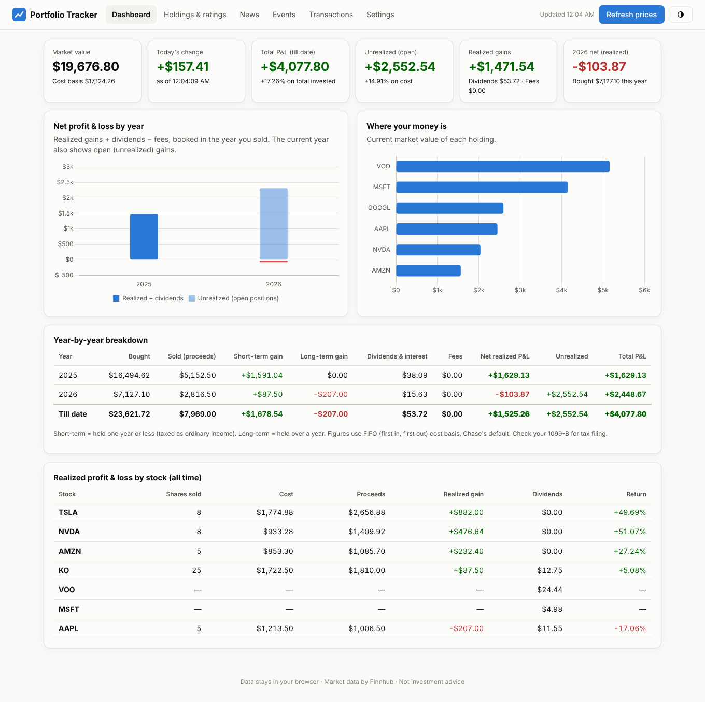
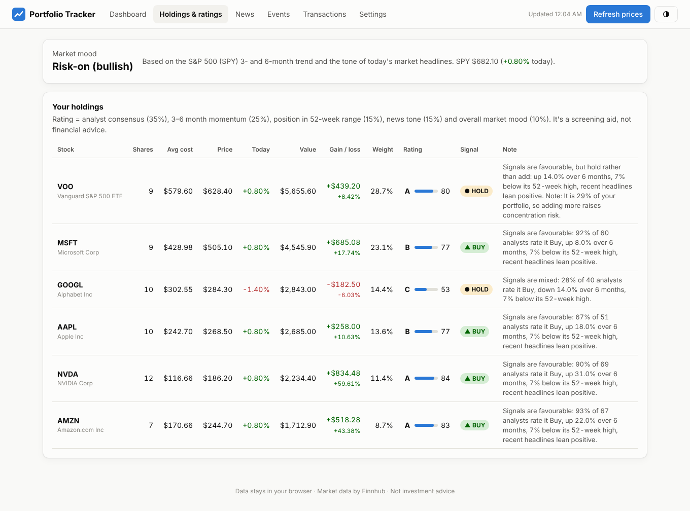

# Portfolio Tracker

A private, in-browser tracker for a **Chase Self-Directed Investing** account (works with other brokers' CSV exports too).

- **Profit & loss by year and till date**: realized gains (short vs long term), dividends, fees, and open (unrealized) gains, using FIFO cost basis.
- **Holdings with a rating** (0–100, grade A–F) and a **Buy / Hold / Sell** signal with a plain-English note for each stock.
- **Latest news** for every stock you own, plus general market headlines.
- **Upcoming events**: earnings dates for your stocks, US jobs reports, CPI inflation reports and Fed rate decisions.
- Light and dark mode, works on phones.




> Screenshots use the sample data and mocked prices.

## Privacy

There is no server. Your transactions and API key are stored only in your browser (`localStorage`). Nothing you import is uploaded or committed to this repo. Use **Transactions → Back up (JSON)** to move your data to another computer.

Don't commit your Chase CSV export to a public repo. The `.gitignore` blocks the default backup and export file names.

## Quick start

1. Get a free API key at [finnhub.io/register](https://finnhub.io/register) (free plan: 60 requests/minute).
2. Open the app (your GitHub Pages link, or run it locally, see below).
3. **Settings** → paste the key → **Save**.
4. **Transactions** → **Choose CSV file** → pick the file downloaded from Chase.

To try it first, click **Settings → Load sample data**.

### Getting your history out of Chase

1. Sign in at chase.com and open your Self-Directed Investing account.
2. Go to **Activity**, set the date range to start before your first trade (e.g. 01/01/2025), and **Download** as CSV. Chase may limit each download to a date range; download several and import each one. Duplicate rows are skipped automatically.
3. Import the file on the **Transactions** tab.

### Past years from your tax forms (1099)

On chase.com go to **Statements & documents → Tax documents**, download each year's 1099 **as CSV**, and choose the files on the **Transactions** tab (several at once is fine). For each year with a 1099, the app uses the form's sales, cost basis (including wash-sale adjustments) and dividends, because that's what the IRS sees. Years without a 1099 are worked out from your trade history. Keep the year in the file name (e.g. `2024-taxdocuments.csv`). Only the sale lots and totals are saved, never your name, address or account number.

A 1099 lists what you sold, not what you bought, so to see your current holdings you still need the trade history going back to your first purchase.

The importer matches columns by name (`Trade Date`, `Type`/`Action`, `Ticker`/`Symbol`, `Quantity`, `Price`, `Amount`, `Commission`), so column order doesn't matter. Rows it can't read are listed after the import. You can also add or delete transactions by hand.

Transaction types: `BUY`, `SELL`, `DIVIDEND`, `INTEREST`, `FEE`, `SPLIT` (quantity = extra shares received), `DEPOSIT`, `WITHDRAWAL`. Dividend reinvestments are imported as buys.

## How the numbers work

| Figure | Meaning |
|---|---|
| Realized gain | Sale proceeds − FIFO cost of the shares sold (fees included). Booked in the year of the sale. |
| Short / long term | Held ≤ 1 year / > 1 year. |
| Net realized P&L | Realized gain + dividends & interest − fees. |
| Unrealized | Today's value − cost of shares you still hold. |
| Total P&L (till date) | All net realized P&L + unrealized. |
| Bought (all trades) | Every purchase added up. Selling and re-buying counts each time, so active trading makes this much bigger than the money you put in. |
| Net new money | Purchases − sale proceeds for the year. |
| Cash added | Deposits − withdrawals (when they're in the trade history). |
| Return % | Total P&L ÷ cash added (or ÷ cost of current holdings if deposits aren't in the history). Simple, not time-weighted. |

Your Chase 1099-B is the source of truth for taxes. If you picked specific tax lots when selling, the per-year split here may differ.

## How the rating works

Each holding gets a weighted score from 0 to 100:

| Signal | Weight | Source |
|---|---|---|
| Analyst consensus | 35% | Latest month of buy/hold/sell recommendations |
| Momentum | 25% | 13- and 26-week price return |
| 52-week range | 15% | Where the price sits between its 52-week low and high |
| News tone | 15% | Keyword scan of the last 7 days of headlines |
| Market mood | 10% | S&P 500 (SPY) trend and general market headlines |

Score ≥ 65 → **BUY**, 40–64 → **HOLD**, < 40 → **SELL**. Then your own position adjusts the advice: a holding over 25% of the portfolio is never "Buy more", big winners get a note about trimming or a trailing stop, and big losers get a note to recheck the reason you bought.

**This is a rules-based screen, not investment advice.** Tune the weights and thresholds in [`js/rating.js`](js/rating.js).

## Economic calendar

Dates for jobs reports, CPI and Fed meetings are in [`js/events.js`](js/events.js), copied from the [BLS](https://www.bls.gov/schedule/news_release/empsit.htm) and [Federal Reserve](https://www.federalreserve.gov/monetarypolicy/fomccalendars.htm) calendars (currently through Dec 2027; 2027 Fed dates are tentative). Add new rows when the agencies publish later schedules.

## Run locally

The app uses ES modules, so it must be served over HTTP (opening `index.html` directly won't work):

```bash
python3 -m http.server 8000
```

Then open http://localhost:8000.

Run the tests (Node 20+):

```bash
npm test
```

## Publish on GitHub Pages

1. Create an empty repository on GitHub, e.g. `portfolio-tracker`.
2. Push this folder to it (replace `YOUR-USERNAME`):

   ```bash
   git remote add origin https://github.com/YOUR-USERNAME/portfolio-tracker.git
   ```

   ```bash
   git push -u origin main
   ```

3. On GitHub: **Settings → Pages → Build and deployment → Source: Deploy from a branch**, branch `main`, folder `/ (root)` → **Save**.
4. After a minute the app is live at `https://YOUR-USERNAME.github.io/portfolio-tracker/`.

The public site contains only the code. Each visitor's data and API key stay in their own browser.

## Project layout

```
index.html            page layout
css/styles.css        styles (light + dark)
js/app.js             UI, charts, data loading
js/portfolio.js       FIFO cost basis, P&L by year
js/csv.js             Chase / broker CSV import
js/rating.js          score, grade, Buy/Hold/Sell note
js/market.js          Finnhub client with caching + rate limiting
js/events.js          jobs / CPI / Fed calendar
js/tax.js             Chase 1099 CSV import
sample/               sample Chase-style CSV
tests/                unit tests (node --test)
```

## License

MIT
